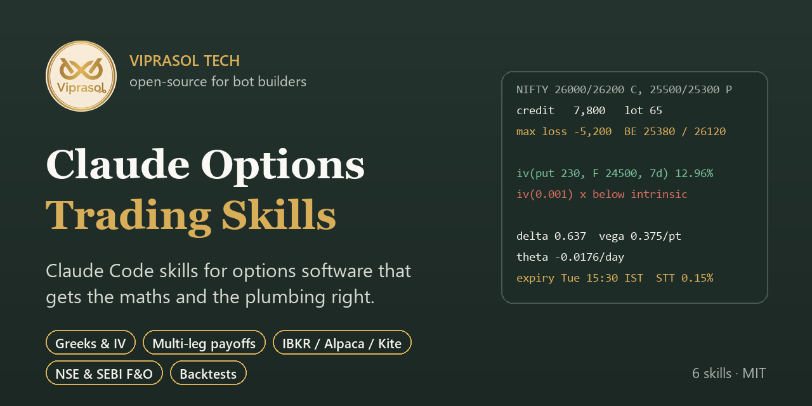

<div align="center">



### Claude Code skills for developers who build options software

**Greeks and implied volatility · exact multi-leg payoffs · option chain data · spread orders on IBKR / Alpaca / Tradier / Kite · NSE & SEBI F&O rules · honest options backtests**<br>
For strategy builders, scanners, risk dashboards and options bots: correct numbers, safe orders.

[](https://github.com/Viprasol-Tech/claude-options-trading-skills/stargazers)
[](LICENSE)
[](https://code.claude.com/docs/en/skills)
[](#-whats-inside)
[](https://github.com/Viprasol-Tech/claude-options-trading-skills/actions/workflows/ci.yml)

[Quick start](#-quick-start) · [What's inside](#-whats-inside) · [Examples](#-just-ask) · [Scripts](#-bundled-scripts) · [Changelog](CHANGELOG.md)

</div>

---

## 💬 Just ask

Install once, then talk to Claude Code normally. The right skill loads by itself.

```text
> My IV solver returns NaN for deep OTM puts and 400% near expiry. Fix it.
> Compute Greeks for this NIFTY option chain off the future, not spot.
> What are the exact breakevens and max loss of this 4-leg iron condor, 65 lot?
> Build an Alpaca mleg order for a put credit spread with a walking limit price.
> Our Kite bot legs into spreads - make it hedge-first and unwind if leg 2 fails.
> What changes on NSE expiry day for margin, STT and stock options?
> Review my 0DTE backtest - it fills at mid on daily bars.
```

## 📦 What's inside

| Skill | What it does |
| --- | --- |
| 🧮 **`options-pricing`** | Black-Scholes-Merton with dividends and **Black-76 off the future**, Greeks with explicit units, time to expiry to the minute, put-call parity, and an IV solver that rejects impossible prices instead of returning garbage. Ships a **calculator**. |
| 🦋 **`options-strategies`** | Exact payoffs, breakevens and max profit/loss for spreads, condors, straddles and covered calls, position Greeks, and what the chart hides: early assignment, pin risk, physical settlement, margin vs max loss, legging. Ships a **payoff tool**. |
| 🗂️ **`options-data`** | OCC/OSI symbols, broker instrument dumps, zoned expiry timestamps (SPX AM vs SPXW PM), bid/ask/mid/mark/last, quote filters, same-time underlying, point-in-time storage. |
| 🧾 **`options-orders`** | Multi-leg orders on **Interactive Brokers** (BAG), **Alpaca** (mleg), **Tradier** (multileg) and **Zerodha Kite** (hedge-first legging), limit pricing, open/close intents, exercise-by-exception, assignment, and the 2026 US pattern-day-trader rule change. |
| 🇮🇳 **`india-fno-rules`** | NSE **Tuesday expiries**, NIFTY-only weeklies, lot sizes (NIFTY 65, BANKNIFTY 30), SEBI's expiry-day margin rules, delta-based limits, **STT from 1 April 2026**, freeze quantities and the F&O pre-open. |
| 🧪 **`options-backtesting`** | Point-in-time chains with expired contracts, bid/ask fills, contract terms by date, settlement and assignment, margin, fees and taxes, intraday data for 0DTE. |

Exchange, regulator and broker facts come from SEBI, NSE, OCC, Cboe, FINRA
and the brokers' own documentation, linked from each skill's `reference.md`
together with the points we could not confirm. Engineering guidance only, not
investment advice.

## ⚡ Quick start

**Option A: Claude Code plugin (recommended)**

```bash
claude plugin marketplace add Viprasol-Tech/claude-options-trading-skills
claude plugin install options-desk@claude-options-trading-skills
```

Skills are then available as `/options-desk:<skill>` and load automatically
when your request matches.

Want every Viprasol plugin? Add the [Viprasol marketplace](https://github.com/Viprasol-Tech/claude-plugins) once:
`claude plugin marketplace add Viprasol-Tech/claude-plugins`, then
`claude plugin install <plugin>@viprasol`.

**Option B: installer** (copies the skills to `~/.claude/skills`)

```bash
git clone https://github.com/Viprasol-Tech/claude-options-trading-skills
cd claude-options-trading-skills
bash install.sh                                        # macOS / Linux
powershell -ExecutionPolicy Bypass -File install.ps1   # Windows
```

No API keys, no accounts, no network calls. The scripts need only Python 3.10+.

## 🧰 Bundled scripts

Standard-library Python with built-in self-tests (textbook prices, Greeks
against finite differences, IV round trips, exact strategy payoffs).

**`options_calc.py`** - prices, Greeks, IV and parity:

```text
$ python options_calc.py price --spot 100 --strike 100 --vol 20 --rate 5 --days 365 --type call
model    Black-Scholes-Merton, European
price    10.450584
delta    0.636831
gamma    0.018762
vega     0.375240
theta    -0.017573
rho      0.532325
$ python options_calc.py iv --future 24500 --strike 24600 --rate 6.5 --days 7 --type put --price 230
model    Black-76 (futures), European
iv       12.9601%
```

**`options_strategy.py`** - exact payoff of any multi-leg position:

```text
$ python options_strategy.py --multiplier 65 "-1 C 26000 120" "+1 C 26200 55" "-1 P 25500 95" "+1 P 25300 40"
net premium   7800 credit
max profit    7800
max loss      -5200
breakevens    25380.00, 26120.00
```

## 🗂️ Repository layout

```text
.claude-plugin/marketplace.json          marketplace manifest
plugins/options-desk/
  .claude-plugin/plugin.json             plugin manifest
  skills/<skill>/SKILL.md                one folder per skill
  skills/<skill>/reference.md            official sources and open questions
  skills/options-pricing/scripts/options_calc.py
  skills/options-strategies/scripts/options_strategy.py
tests/validate_repo.py                   CI: manifests, frontmatter, links, scripts
```

## ⚠️ Disclaimer

This project is for **educational and engineering purposes only** and is **not
financial, investment, tax or legal advice**. Options can lose more than the
premium paid when sold short, and leverage magnifies losses. Generated code
can contain bugs: test with paper accounts first. Exchange rules, lot sizes,
taxes and broker APIs change; confirm them before relying on a number.
Viprasol Tech is not affiliated with SEBI, NSE, OCC, Cboe, FINRA, Interactive
Brokers, Alpaca, Tradier, Zerodha, Anthropic or any exchange mentioned here.

## 🤝 Contributing

Corrections with a link to the official source are the most valuable
contribution. See [CONTRIBUTING.md](CONTRIBUTING.md) and run
`python tests/validate_repo.py` before opening a PR. More free Claude Code
packs from Viprasol:
[claude-market-data-skills](https://github.com/Viprasol-Tech/claude-market-data-skills) ·
[claude-prop-firm-skills](https://github.com/Viprasol-Tech/claude-prop-firm-skills) ·
[claude-trading-skills](https://github.com/Viprasol-Tech/claude-trading-skills) ·
[claude-tradingview-automation-skills](https://github.com/Viprasol-Tech/claude-tradingview-automation-skills) ·
[claude-crypto-bot-skills](https://github.com/Viprasol-Tech/claude-crypto-bot-skills) ·
[claude-india-stack-skills](https://github.com/Viprasol-Tech/claude-india-stack-skills) ·
[claude-fintech-skills](https://github.com/Viprasol-Tech/claude-fintech-skills) ·
[claude-voice-agent-skills](https://github.com/Viprasol-Tech/claude-voice-agent-skills) ·
[claude-video-editing-skills](https://github.com/Viprasol-Tech/claude-video-editing-skills).

## 📬 Contact — Viprasol Tech Private Limited

Building an options analytics platform, strategy builder or execution
system? We design and build them.

- 🌐 Website: [viprasol.com](https://viprasol.com)
- ✉️ Email: [support@viprasol.com](mailto:support@viprasol.com)
- 💬 Telegram: [t.me/viprasol_help](https://t.me/viprasol_help) · 📱 WhatsApp: +91 96336 52112
- 🐙 GitHub: [@Viprasol-Tech](https://github.com/Viprasol-Tech) · 💼 [LinkedIn](https://www.linkedin.com/in/viprasol/) · 𝕏 [@viprasol](https://twitter.com/viprasol)
- 📈 TradingView: [@viprasol](https://www.tradingview.com/u/viprasol/) · MQL5: [viprasol](https://www.mql5.com/en/users/viprasol)

## License

[MIT](LICENSE) © 2026 Viprasol Tech Private Limited
